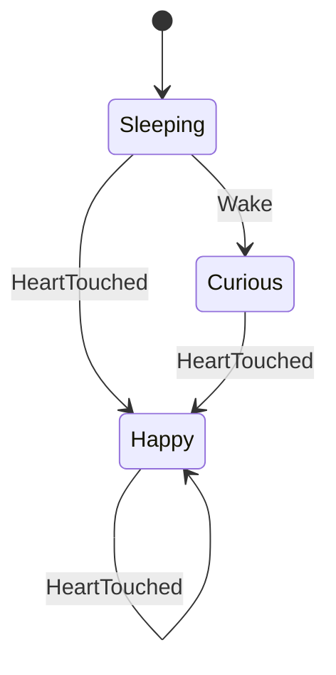

# 19 – Zustandsmaschinen und zeitgesteuertes Verhalten

## Lernziel

Du kannst Robins Verhalten als Zustände und Übergänge beschreiben, Ereignisse von Zuständen unterscheiden und Zeitbedingungen ohne blockierendes Warten auswerten. C# ist der Anker. TypeScript zeigt eine explizite Übergangsfunktion; C++17 verwendet anschliessend den tatsächlichen Pink-Robin-Core.

Wir verbinden Events aus [Kapitel 15](15-events-callbacks-und-nachrichten.md), geordnete Verarbeitung aus [Kapitel 16](16-asynchronitaet-und-nebenlaeufigkeit.md) und Grenztests aus [Kapitel 18](18-testen-und-debugging.md).

## A. Spickzettel

| Begriff | Bedeutung | Pink-Robin-Beispiel |
|---|---|---|
| Zustand | Was aktuell gilt | Robin schläft |
| Ereignis | Was passiert ist | Herz wurde berührt |
| Übergang | Änderung aufgrund einer Regel | schlafend → wach |
| Guard | Bedingung für einen Übergang | Kopfkontakt dauert mindestens 5000 ms |
| Aktion | Folge eines Übergangs oder Ereignisses | Stimmung und Ausdruck setzen |
| Zeitkontext | Für spätere Entscheidungen benötigte Zeitdaten | Beginn der letzten Herzreaktion |
| Snapshot | Nach aussen sichtbarer Zustand zu einem Zeitpunkt | Mode, Mood, Expression, Revision |
| Invariante | Regel, die in allen erreichbaren Zuständen gelten soll | Herzreaktion und aktiver Kopfkontakt schliessen sich hier aus |

Ein Zustandsautomat macht Regeln ausdrücklich. Er benötigt weder eine zusätzliche Bibliothek noch eine Klasse pro Zustand. Für komplexere hierarchische und parallele Modelle gibt es Statecharts; die [W3C-SCXML-Spezifikation](https://www.w3.org/TR/scxml/) beschreibt solche Konzepte. Unser Lernbeispiel verwendet keinen SCXML-Interpreter.

## B. Zuerst ein kleines Modell verstehen

Nehmen wir zunächst nur drei Zustände und zwei Ereignisse:



Der Kreis bei `Happy` sagt: Eine weitere Berührung darf verarbeitet werden, auch wenn der sichtbare Zustandsname gleich bleibt. Im echten Core startet sie die Reaktionsdauer erneut. Derselbe Zustand nach einem Ereignis bedeutet also nicht zwingend „nichts ist passiert“.

Das Diagramm ist absichtlich reduziert: Es enthält noch keine Zeit, keinen Kopfkontakt und keinen Neustart. Nicht eingezeichnete Ereignisse brauchen trotzdem einen Vertrag – ignorieren, ablehnen oder einen definierten weiteren Übergang ausführen.

## C. C# als Anker: eine explizite Übergangsfunktion

Das folgende vollständige Programm implementiert nur das reduzierte Diagramm, **nicht den gesamten Pink-Robin-Core**:

```csharp
using System;

public enum RobinState { Sleeping, Curious, Happy }
public enum RobinEvent { Wake, HeartTouched }

public static class Program
{
    public static RobinState Next(RobinState state, RobinEvent input)
    {
        return (state, input) switch
        {
            (RobinState.Sleeping, RobinEvent.Wake) => RobinState.Curious,
            (RobinState.Curious, RobinEvent.Wake) => RobinState.Curious,
            (RobinState.Happy, RobinEvent.Wake) => RobinState.Happy,
            (RobinState.Sleeping, RobinEvent.HeartTouched) => RobinState.Happy,
            (RobinState.Curious, RobinEvent.HeartTouched) => RobinState.Happy,
            (RobinState.Happy, RobinEvent.HeartTouched) => RobinState.Happy,
            _ => throw new ArgumentOutOfRangeException()
        };
    }

    public static void Main()
    {
        var state = RobinState.Sleeping;
        state = Next(state, RobinEvent.Wake);
        Console.WriteLine(state); // Curious
        state = Next(state, RobinEvent.HeartTouched);
        Console.WriteLine(state); // Happy
    }
}
```

Die Funktion berechnet aus Zustand und Ereignis den nächsten Zustand. Sie startet weder Timer noch Netzwerkzugriffe. Dadurch ist sie leicht reproduzierbar zu testen. Der zusätzliche `Wake` in bereits wachen Zuständen wird hier bewusst ignoriert. Unbekannte Enum-Werte werden abgelehnt, statt unbeabsichtigt eine Standardreaktion auszulösen.

**Achtung, C#-Gehirn:** Nicht jedes Enum ist bereits eine vollständige Zustandsmaschine. Ohne Übergangsregeln, Kontext und Fehlervertrag stehen dort nur Namen. Ebenso wenig muss ein Automat durch eine Vererbungshierarchie mit `SleepingState`, `HappyState` usw. umgesetzt werden.

## D. TypeScript: Ereignisse ausdrücklich begrenzen

```typescript
type RobinState = "sleeping" | "curious" | "happy";
type RobinEvent =
    | { type: "wake" }
    | { type: "heart_touched" };

function unreachable(value: never): never {
    throw new Error("Unbekanntes Ereignis");
}

function next(state: RobinState, event: RobinEvent): RobinState {
    switch (event.type) {
        case "wake":
            return state === "sleeping" ? "curious" : state;
        case "heart_touched":
            return "happy";
        default:
            return unreachable(event);
    }
}

console.log(next("sleeping", { type: "wake" }));          // curious
console.log(next("curious", { type: "heart_touched" })); // happy
```

Der `never`-Zweig hilft bei der Typprüfung: Erweitern wir die Ereignis-Union und vergessen einen Fall, passt das übrig gebliebene Ereignis nicht zu `never`. Das ist keine Laufzeitvalidierung beliebiger JSON-Daten. Externe Nachrichten werden zuerst nach Kapitel 17 geprüft und dann in ein internes Ereignis übersetzt.

Für diesen kleinen Fall genügt eine Funktion. Eine reine Funktion kann auch Kontext und anstehende Ausgaben zurückgeben, beispielsweise `{ state, effects }`. Die Effekte führt anschliessend ein Adapter aus. So bleibt die Entscheidungslogik von tatsächlichen Geräte- und Netzwerkzugriffen getrennt.

## E. Der tatsächliche Core hat mehrere Zustandsdimensionen

Im [aktuellen Core](../core/include/pinkrobin/core.hpp) sind getrennt:

- **Mode:** `sleeping`, `waking`, `awake`.
- **Mood:** `curious`, `happy`, `affectionate`.
- **Expression:** `sleeping`, `curious`, `happy`, `heart_eyes`.

Ein schlafender Robin kann intern bereits `Mood::curious` haben und trotzdem schlafende Augen zeigen. Stimmung, Wachmodus und Ausgabe sind nicht austauschbare Namen derselben Information.

Zusätzlich speichert der Core Kontaktstatus, eine laufende Herzreaktion und Zeitmarken. Der Snapshot ist deshalb nicht automatisch ein vollständiger Speicherstand zur späteren Wiederherstellung: Er enthält nicht sämtliche privaten Zeit- und Übergangsdaten.

Mehrere Dimensionen vermeiden ein übergrosses Enum mit Namen wie `AwakeHappyWithHeartReaction`. Sie dürfen sich aber nicht beliebig widersprechen. Die Übergänge müssen erlaubte Kombinationen herstellen. Viele unabhängige boolesche Flags ohne solche Regeln würden dagegen unklare Kombinationen begünstigen.

Die folgende Tabelle fasst den bestehenden [Verhaltensvertrag](../core/README.md) zusammen:

| Auslöser / Bedingung | Wirkung |
|---|---|
| Erstellen oder Neustart | schlafend, neugierige Stimmung, schlafender Ausdruck; Reaktionen zurücksetzen |
| 4000 ms seit Start / Neustart | aufwachend, neugieriger Ausdruck |
| Insgesamt 7100 ms seit Start / Neustart | wach und neugierig |
| Herzberührung | sofort wach und glücklich; neue Herzfrist von 6000 ms; Kopfkontakt beenden |
| Erneute Herzberührung | Herzfrist ab dieser Berührung neu beginnen |
| Neuer Kopfkontakt | wach und glücklich; Kopfkontakt und dessen Start merken; Herzreaktion beenden |
| Bereits laufender Kopfkontakt beginnt erneut | Beginn nicht verschieben |
| Kopfkontakt besteht mindestens 5000 ms | `affectionate`, Herzaugen bis Kontaktende |
| Kopfende / Interaktionsabbruch bei aktivem Kopfkontakt | neugierig; Kontakt beenden |
| Alte Kopfende-Meldung ohne aktiven Kopfkontakt | keine neue Reaktion auslösen |

Diese Prioritäten sind fachliche Entscheidungen. Ein anderer Roboter könnte andere Regeln brauchen; sie entstehen nicht automatisch aus dem Begriff Zustandsmaschine.

## F. Zeit als Eingabe statt blockierend warten

Eine Herzreaktion bedeutet nicht: „6000 ms schlafen und danach das Gesicht ändern“. Der Core merkt sich den Beginn und prüft bei späterem Zeitfortschritt, ob genug Zeit vergangen ist.

```text
Start der Herzreaktion: 100 ms
Prüfung bei 6099 ms:    5999 ms vergangen → weiterhin happy
Prüfung bei 6100 ms:    6000 ms vergangen → curious
```

Der Adapter liefert fortlaufende monotone Millisekunden aus derselben Zeitbasis. Eine Änderung von Zeitzone oder Kalenderuhr darf Robins Reaktionsdauer nicht verändern. Der Adapter muss ausserdem die konkrete Plattformuhr und gegebenenfalls Hardwaretimer-Überläufe richtig behandeln.

Im Core wird nach Prüfung der Zeitreihenfolge mit einer Differenz wie `now - started` gearbeitet. Das vermeidet hier den möglichen Überlauf beim Bilden einer Deadline `started + duration` nahe dem Ende des 64-Bit-Bereichs. Diese Rechnung ist nur unter ihrem Zeitvertrag sinnvoll; ein negativer oder rückwärts laufender Wert darf nicht unkontrolliert als unsigned Differenz interpretiert werden.

Ein Aufruf von `snapshot()` lässt keine Zeit verstreichen. Der Adapter muss `advance_to` beziehungsweise die C-API-Entsprechung regelmässig auslösen. Scheduler und Betriebssystem können verspätet aufrufen. Die fachliche Regel verwendet trotzdem die verstrichene Zeit statt einer gezählten Zahl von Timer-Ticks. Ob ein Timer um exakt eine Millisekunde pünktlich ausführt, ist eine andere Frage als die deterministische Core-Regel.

## G. Reihenfolge und grosse Zeitsprünge

Die [Implementierung](../core/src/core.cpp) verarbeitet ein Ereignis in dieser Reihenfolge:

1. Ereigniskennung validieren. Eine unbekannte Kennung verändert auch die Zeit nicht.
2. Rückwärtszeit ablehnen; ansonsten Zeit bis zum Ereigniszeitpunkt fortschreiben.
3. Alle durch diesen Zeitfortschritt ausgelösten Regeln in der festgelegten Reihenfolge auswerten.
4. Das eigentliche Ereignis verarbeiten.

Damit gilt: **Zeitübergänge vor dem Ereignis desselben Zeitpunkts.** Läuft die Herzfrist bei `6100` ms ab und kommt dort eine neue Herzberührung, wird zuerst der Ablauf verarbeitet und dann eine neue Herzreaktion begonnen. Der sichtbare Endzustand ist wieder glücklich; intern können trotzdem mehrere Änderungen und Revisionsschritte stattgefunden haben.

Bei einem Sprung von `0` auf `10000` ms muss das Aufwachen vollständig nachgeholt werden. Eine einzelne `if/else if`-Kette könnte versehentlich nur den ersten fälligen Schritt abarbeiten. Der bestehende Core prüft die aufeinanderfolgenden Phasen so, dass der grössere Sprung zum richtigen Zustand führt. Bei künftig komplexeren Automaten braucht das Nachholen eine ausdrückliche Strategie, die auch Endlosschleifen ausschliesst.

Zwei unterschiedliche Ereignisse mit identischem Zeitwert werden weiterhin in Aufrufreihenfolge verarbeitet. Ein gemeinsamer Zeitstempel macht sie nicht gleichzeitig oder vertauschbar. Der Adapter serialisiert deshalb pro Sitzung und legt die Reihenfolge fest.

## H. C++17-Praxis: Unterbrechung und stale Ereignisse

Dieses vollständige Lernprogramm verwendet die echte Core-API. Es prüft auch im Release-Build seine Erwartungen:

```cpp
#include "pinkrobin/core.hpp"
#include <iostream>
#include <stdexcept>

void require(bool condition, const char* message)
{
    if (!condition)
        throw std::runtime_error{message};
}

int main()
{
    using namespace pinkrobin;
    try {
        Core core{0};
        require(core.dispatch(Event::head_started, 100) == Result::ok,
                "Kopfkontakt abgelehnt");
        require(core.dispatch(Event::head_started, 5000) == Result::ok,
                "Wiederholter Beginn abgelehnt");
        require(core.advance_to(5100) == Result::ok, "Zeitfehler");
        require(core.snapshot().expression == Expression::heart_eyes,
                "Wiederholung hat Kopfkontaktfrist verschoben");

        require(core.dispatch(Event::heart_touched, 5200) == Result::ok,
                "Herzereignis abgelehnt");
        require(!core.snapshot().head_contact, "Kopfkontakt blieb aktiv");
        require(core.dispatch(Event::head_ended, 5300) == Result::ok,
                "Altes Kopfende abgelehnt");
        require(core.snapshot().mood == Mood::happy,
                "Altes Kopfende hat Herzreaktion aufgehoben");

        require(core.advance_to(11199) == Result::ok, "Zeitfehler");
        require(core.snapshot().mood == Mood::happy, "Herzreaktion zu kurz");
        require(core.advance_to(11200) == Result::ok, "Zeitfehler");
        require(core.snapshot().mood == Mood::curious,
                "Herzreaktion ist nicht abgelaufen");
        std::cout << "Kontakt, Unterbrechung und Zeitgrenze stimmen\n";
        return 0;
    } catch (const std::exception& error) {
        std::cerr << error.what() << '\n';
        return 1;
    }
}
```

Ein alter Timeout-Callback könnte in einem anders entworfenen System ebenfalls eine neue Reaktion versehentlich beenden. Mögliche Gegenmittel sind ein Abbruchvertrag, eine Reaktionsgeneration oder die zentrale Fristprüfung wie hier. Nur den Timer zu stoppen garantiert bei manchen Scheduler-APIs nicht, dass ein bereits gestarteter Callback nicht mehr läuft.

## I. Zustandsmaschine und Darstellung trennen

Der Core wählt einen benannten Ausdruck. Blinzeln, Blickanimation, Herzleuchten und reduzierte Bewegung bleiben laut Core-Vertrag beim Ausgabeadapter. Eine Animation darf die fachliche Frist nicht durch ihr eigenes Ende neu definieren.

Auch lang laufende Aktionen gehören nicht blockierend in den Übergang: Der Automat kann einen Auftrag erzeugen und später dessen Ergebnis als neues Ereignis erhalten. Für solche Erweiterungen explizit festlegen, welche Ergebnisse nach einem Neustart oder Sitzungswechsel noch gültig sind. Eine alte Antwort darf nicht eine neue Zustandsphase überschreiben.

Pro Sitzung besitzt ein Verantwortlicher die Instanz und verarbeitet einen Schritt vollständig, bevor der nächste beginnt. Währenddessen keine unbekannten Callbacks in den Core zurückrufen lassen. Snapshots als Werte kopieren und anschliessend ausserhalb des Core-Zugriffs an die Ausgabe weitergeben.

**Achtung, C#-Gehirn:** Ein Zustandsautomat ist nicht automatisch threadsicher, nur weil jeder Übergang kurz ist. Und deterministisch bedeutet „gleiche geordnete Eingaben und gleicher Anfangskontext ergeben dasselbe Resultat“, nicht „alle Ereignisreihenfolgen ergeben dasselbe“.

## J. Regeln systematisch testen

Eine Übergangstabelle lässt sich direkt in Testfälle übersetzen:

| Prüfklasse | Beispiel |
|---|---|
| Zustandseintritt | Herzberührung weckt Robin sofort |
| Zeitgrenze | 4999 / 5000 ms seit Kopfkontaktbeginn |
| Wiederholung | erneuter Kopfstart verschiebt den Beginn nicht |
| Unterbrechung | Herzberührung beendet Kopfkontakt |
| Veraltete Eingabe | nachfolgendes Kopfende hebt die Herzreaktion nicht auf |
| Neustart | alte Reaktionen und Kontaktstatus verwerfen |
| Zeitfehler | rückwärts laufende Zeit ohne Zustandsänderung ablehnen |
| Grosser Sprung | alle fälligen Aufwachphasen nachholen |
| Isolation | Ereignisse einer Sitzung verändern keine andere Instanz |

Nicht nur Endzustände testen: Auch Ergebniscode, Kontaktstatus und unveränderter Zustand nach Ablehnung gehören zum Vertrag. Die vorhandenen [Core-Tests](../core/tests/core_tests.cpp) decken bereits viele dieser Szenarien ab. Zusätzliche generierte Ereignisfolgen können Invarianten prüfen, ersetzen aber keine bewusst gewählten Grenzfälle.

## K. Miniübung

Berechne den Zustand nach jedem Schritt, ohne echte Zeit verstreichen zu lassen:

```text
Core bei 0 erstellen
head_started bei 100
head_started bei 4000
advance_to 5100
heart_touched bei 5200
head_ended bei 5300
heart_touched bei 6000
advance_to 11200
advance_to 12000
```

1. Wann erscheinen erstmals Herzaugen?
2. Warum beendet das Kopfende bei `5300` ms die Freude nicht?
3. Warum ist Robin bei `11200` ms noch glücklich?
4. Was würde ein Neustart bei `7000` ms an diesem Ablauf ändern?

<details>
<summary>Lösung anzeigen</summary>

Herzaugen erscheinen bei `5100` ms: Der wiederholte Kopfstart bei `4000` verschiebt den ursprünglichen Beginn bei `100` nicht. Die Herzberührung bei `5200` beendet den Kopfkontakt und startet eine Herzreaktion; das alte Kopfende hat danach keinen aktiven Kontakt mehr zu beenden. Die Berührung bei `6000` beginnt die Herzfrist erneut. Deshalb bleibt Robin bei `11200` glücklich und wird bei `12000` neugierig.

Ein stattdessen eingefügter Neustart bei `7000` verwirft die laufende Herzreaktion und startet das Aufwachen neu. Bei `11200` wäre Robin aufwachend, bei `12000` weiterhin aufwachend; vollständig wach erst ab `14100` ms, sofern kein weiteres Ereignis eingreift.

</details>

## Merksätze – Achtung, C#-Gehirn!

- Zustand, Ereignis, Übergang, Bedingung und Aktion getrennt benennen.
- Ein sichtbarer Zustand allein enthält nicht zwingend den gesamten Entscheidungskontext.
- Zeitwerte übergeben und verstrichene Dauer prüfen, statt den Core schlafen zu legen.
- Wiederholungen, Unterbrechungen und Ereignisse an derselben Zeitgrenze brauchen klare Regeln.
- Die Reihenfolge von Eingaben ist Teil des Verhaltensvertrags.
- Fachliche Entscheidung und animierte Darstellung bleiben getrennt.
- Robins Verhalten mit expliziten Zeitwerten und gezielten Ereignisfolgen reproduzierbar testen.

[← 18 – Testen und Debugging](18-testen-und-debugging.md) · [Inhaltsverzeichnis](README.md) · [20 – Native Anbindung: C# ↔ C++ →](20-native-anbindung-csharp-cpp.md)
