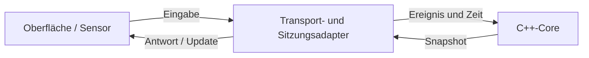

# 22 – Architektur und Abhängigkeitsgrenzen

## Lernziel

Du kannst erklären, welche Verantwortung zu Core, Adapter, Backend und Oberfläche gehört. Du unterscheidest Datenfluss von Quellcode-Abhängigkeiten und entwirfst kleine Schnittstellen mit klarer Lebensdauer.

Wir setzen die bisherigen Kapitel zusammen: Zustandsmaschinen, native Anbindung und Netzwerkkommunikation. **Dieses Kapitel beschreibt Lernentwürfe und die vorhandenen Grenzen; es baut weder die Backend-Core-Verbindung noch neue Sitzungs- oder Steuerungsendpunkte ein.**

## A. Spickzettel

| Verantwortung | C# / Backend | TypeScript / Oberfläche | C++-Core |
|---|---|---|---|
| Fremde Nachrichten prüfen | Struktur, erlaubte Aktion und Berechtigung | vor Verwendung prüfen; ersetzt nicht die Serverprüfung | erhält bereits abgebildete Ereignisse; prüft eigenen API-Vertrag |
| Fachliche Reaktion | Core aufrufen, keine zweite Verhaltenslogik | Zustand darstellen | Übergänge und Reaktionsfristen entscheiden |
| Sitzung und Lebensdauer | Instanz zuordnen, Zugriffe ordnen, Handle freigeben | Ansicht und Verbindung verwalten | Zustand pro Instanz halten |
| Zeit | vertrauenswürdige monotone Zeit liefern | lokale Animation und UI-Zeit | übergebene Zeit auswerten |
| Transport | HTTP / später SignalR adaptieren | Requests und Nachrichten behandeln | kein HTTP oder WebSocket |
| Darstellung | Antwortmodell abbilden | Augen, Animation, reduzierte Bewegung | benannten Ausdruck liefern |
| Austauschbarkeit | Konstruktorabhängigkeiten / Interfaces | injizierte Funktionen / Dienste | Werte, Komposition, gezielte Schnittstellen |

Eine **Grenze** trennt Verantwortlichkeiten und schützt einen Vertrag. Ein zusätzlicher Ordner allein schafft noch keine solche Grenze.

## B. Datenfluss ist nicht dasselbe wie Abhängigkeit

Der geplante Ablauf einer Berührung ist:



Die Rückgabe eines Snapshots bedeutet nicht, dass der Core die Angular-Komponente kennen muss. Seine Funktion liefert einen Wert zurück. Erst der Adapter weiss, wohin dieser Wert weitergeht.

Eine Quellcode-Abhängigkeit besteht dagegen beispielsweise, wenn eine Datei einen HTTP-Typ importiert oder eine Klasse den Konstruktor einer konkreten Datenbankimplementierung aufruft. Solche Abhängigkeiten bestimmen, was beim Kompilieren, Testen und Ändern gemeinsam benötigt wird.

Unser Ziel: Der Core benötigt seine fachlichen Typen und die passende Standardbibliothek, keine Browser-, ASP.NET- oder Netzwerktypen. Die Umgebung darf den Core kennen, ohne dass er ihre Infrastruktur kennt.

## C. C# als Anker: benötigte Fähigkeiten injizieren

Statt eine native Sitzung tief in einer Request-Methode zu erzeugen, kann ein Anwendungsablauf eine benötigte Fähigkeit über den Konstruktor erhalten. Dadurch bleiben Aufbau und Nutzung getrennt.

Der folgende vollständige Konsolenentwurf zeigt **nur diese Zusammenarbeit**. `ProbeSession` ist ein Test-Double mit vorbereiteter Antwort, keine zweite Implementierung von Robins Verhalten und keine vorhandene Repository-Klasse:

```csharp
using System;

public sealed record ExpressionSnapshot(string Expression, ulong Revision);

public interface IHeartSession
{
    ExpressionSnapshot TouchHeart();
}

public sealed class TouchHeartUseCase
{
    private readonly IHeartSession session;

    public TouchHeartUseCase(IHeartSession session)
    {
        this.session = session;
    }

    public ExpressionSnapshot Execute()
    {
        return session.TouchHeart();
    }
}

public sealed class ProbeSession : IHeartSession
{
    public int Calls { get; private set; }

    public ExpressionSnapshot TouchHeart()
    {
        ++Calls;
        return new ExpressionSnapshot("happy", 1);
    }
}

public static class Program
{
    public static void Main()
    {
        var probe = new ProbeSession();
        var useCase = new TouchHeartUseCase(probe);
        var result = useCase.Execute();
        if (probe.Calls != 1 || result.Expression != "happy")
            throw new InvalidOperationException("Zusammenarbeit stimmt nicht");
        Console.WriteLine(result.Expression);
    }
}
```

Die echte Umsetzung von `IHeartSession` würde den geordneten Sitzungsadapter und dahinter die native Anbindung verwenden. Sie ermittelt die vertrauenswürdige Zeit am richtigen Ort; ein Request soll sie nicht beliebig vorgeben. Berechtigungsprüfung und Sitzungsauflösung müssen vor Ausführung abgesichert sein. Diese Aufgaben wurden nicht durch das Interface erledigt.

Der Use Case **leiht** die Sitzung für seine Arbeit. Er erzeugt und zerstört sie hier nicht. Der zuständige Besitzer muss die Lebensdauer garantieren. Ein Konstruktorparameter erklärt eine Abhängigkeit, aber ohne weiteren Vertrag noch nicht deren Ownership.

Das Interface gehört zur Seite, die diese Fähigkeit benötigt; die technische Umsetzung erfüllt den Vertrag. So kann der Ablauf zur Laufzeit eine native Umsetzung verwenden, ohne deren P/Invoke-Details im Quellcode zu benötigen. Dieses Prinzip heisst **Dependency Inversion**. [Microsoft: Architekturprinzipien](https://learn.microsoft.com/dotnet/standard/modern-web-apps-azure-architecture/architectural-principles)

**Achtung, C#-Gehirn:** Dependency Injection benötigt keinen Container. `new TouchHeartUseCase(probe)` ist bereits Konstruktorinjektion. Und nicht jede Klasse benötigt ein Interface: Eine konkrete, stabile Abhängigkeit kann vollkommen ausreichen.

## D. Zusammensetzen am Einstiegspunkt

Der **Composition Root** ist der Ort, an dem die Anwendung ihre konkreten Komponenten auswählt und zusammensetzt, beispielsweise beim Backend-Start. Dort dürfen Infrastrukturdetails bekannt sein.

Ein späterer Aufbau könnte eine native Gateway-Implementierung, einen begrenzten Sitzungsmanager und die Transportendpunkte verbinden. Das bestehende [Backend](../backend/README.md) benennt bereits `IRobinCoreGateway` als Grenze zur künftigen Core-Anbindung. Das Lerninterface oben ersetzt diese vorhandene Grenze nicht und legt ihre Methodensignaturen nicht fest.

Abhängigkeiten nicht überall über einen globalen `IServiceProvider` suchen. Das versteckt Voraussetzungen und erschwert Tests. Konstruktoren sollen die benötigten Dienste sichtbar machen. Ebenso wenig muss der Core für Testbarkeit lernen, wie ein Webserver seinen Container konfiguriert.

### DI-Lebensdauer ist keine fachliche Sitzung

| DI-Begriff | Bedeutung | Mögliche Verwechslung |
|---|---|---|
| Transient | neue Instanz pro Auflösung | muss nicht bis zum Ende einer Robin-Sitzung leben |
| Scoped | eine Instanz pro Scope | in ASP.NET Core häufig Request-Scope, nicht automatisch Browser-Sitzung |
| Singleton | eine Instanz im Container-Lebenszyklus | darf nicht versehentlich den veränderlichen Zustand aller Robins teilen |

Ein Singleton-Sitzungsmanager kann mehrere getrennte Sitzungen verwalten. Das ist etwas anderes als ein einzelner Singleton-Core für alle Besucher. Jede Sitzung braucht einen klaren Besitzer, begrenzte Kapazität, Ablaufregeln und einen geordneten Abschluss.

Scoped-Dienste nicht dauerhaft in Singletons festhalten. Bei containerverwalteten Ressourcen die Entsorgungsverantwortung beachten. Ein eigener fachlicher Sitzungsmanager muss seinen Besitz separat und ausdrücklich regeln. [Microsoft: Dienstlebensdauern](https://learn.microsoft.com/en-us/dotnet/core/extensions/dependency-injection/service-lifetimes)

## E. TypeScript: Anzeigen statt Verhalten nachbauen

Die Oberfläche darf einen Snapshot in ein Darstellungsmodell übersetzen. Sie sollte bei echter Core-Anbindung nicht parallel noch einmal entscheiden, wann die Herzreaktion fachlich endet.

```typescript
type Expression = "sleeping" | "curious" | "happy" | "heart_eyes";
type ViewModel = { eyes: "closed" | "round" | "smile" | "hearts" };

function toView(expression: Expression): ViewModel {
    switch (expression) {
        case "sleeping": return { eyes: "closed" };
        case "curious": return { eyes: "round" };
        case "happy": return { eyes: "smile" };
        case "heart_eyes": return { eyes: "hearts" };
    }
}

console.log(toView("happy").eyes); // smile
```

Das ist eine reine Projektion bereits geprüfter Daten. Wie die Augen gezeichnet oder animiert werden, bleibt bei der Darstellung. Unbekannte Nachrichten zuerst validieren; die TypeScript-Union allein schützt keine Netzwerkgrenze.

Ein lokaler Demo-Modus kann bewusst ein eigenes Simulationsmodell besitzen. Dann muss klar erkennbar sein, dass die Demo keine Core-Verbindung nachweist. Bei der späteren Umstellung nicht unbemerkt beide fachlichen Timer gleichzeitig aktiv lassen. Sonst kann die UI eine Reaktion beenden, die der Core noch für gültig hält.

Transportcode, View-Modell und Zeichnung müssen nicht drei eigene Pakete werden. Bereits kleine Module mit klaren Eingaben und ohne versteckte Seiteneffekte können die gewünschte Trennung erreichen.

## F. C++17: Core als enthaltene Komponente

Der aktuelle Core ist `final`; ein Netzwerkadapter muss ihn nicht beerben. Er kann ihn als Wert besitzen. Dieses vollständige Lernprogramm zeigt einen kleinen Adapter mit der echten [Core-API](../core/include/pinkrobin/core.hpp):

```cpp
#include "pinkrobin/core.hpp"
#include <cstdint>
#include <stdexcept>

class LocalSession final {
public:
    pinkrobin::Snapshot touchHeart(std::uint64_t trustedNow)
    {
        const auto result = core_.dispatch(
            pinkrobin::Event::heart_touched, trustedNow);
        if (result != pinkrobin::Result::ok)
            throw std::runtime_error{"Core-Aufruf abgelehnt"};
        return core_.snapshot();
    }

private:
    pinkrobin::Core core_{0};
};

int main()
{
    LocalSession session;
    const auto state = session.touchHeart(100);
    if (state.mood != pinkrobin::Mood::happy)
        return 1;
    return 0;
}
```

Der Adapter enthält keine JSON- oder Socket-Typen. Für eine reale Verwendung muss seine aufrufende Umgebung vertrauenswürdige Zeit, Lebensdauer und serialisierte Zugriffe sicherstellen. Dieses Beispiel ist synchron, besitzt keine Queue und ist nicht für ungeschützte parallele Aufrufe gedacht.

Eine C#-Implementierung verwendet statt direkter C++-Komposition die C-ABI und `SafeHandle` aus Kapitel 20. Der fachliche Kern kann derselbe bleiben; nur die technische Grenzüberquerung unterscheidet sich.

## G. Verträge übersetzen statt interne Typen überall verteilen

Eine Berührung durchläuft mehrere Darstellungen:

```text
HTTP-/Hub-Nachricht
    → validiertes Eingabemodell
    → autorisierte, zugeordnete Sitzungsaktion
    → Core-Ereignis und vertrauenswürdige Zeit
    → nativer Snapshot
    → Antwort-DTO
    → View-Modell
```

Diese Modelle können dieselbe fachliche Information ausdrücken und trotzdem unterschiedliche Felder haben. Der JSON-Vertrag braucht etwa stabile Namen; die C-ABI braucht feste Breiten und Layout; die Ansicht braucht zeichnungsrelevante Werte.

Nicht für jedes Feld reflexartig eine neue Klasse erfinden. Ein Mapping ist dann hilfreich, wenn es eine echte Grenze sichtbar macht: Validierung, Zahlenformat, Versionsunterschied, Besitz oder bewusst eingeschränkte Ausgabe. Interne Pointer und native Struct-Layouts haben in Browsernachrichten nichts zu suchen.

Versionen ebenfalls auseinanderhalten: HTTP-API-Version, JSON-Nachrichtenschema und native ABI-Version können sich unabhängig ändern. Eine neue Augenanimation erfordert beispielsweise nicht automatisch eine neue native ABI.

## H. Wer entscheidet was?

| Frage | Zuständige Stelle |
|---|---|
| Ist die JSON-Struktur gültig? | Transport-/Validierungsadapter |
| Darf die Nutzerin diese Sitzung bedienen? | Backend-Berechtigung und Sitzungszuordnung |
| Welcher Core gehört zur Sitzung? | Sitzungsverwaltung |
| In welcher Reihenfolge kommen Ereignisse an? | geordneter Sitzungsadapter |
| Wie lange wirkt eine Herzberührung? | Core-Verhalten |
| Wie wird `heart_eyes` gezeichnet? | Darstellungsadapter |
| Was passiert bei Verbindungsverlust mit laufendem Kontakt? | ausdrücklich definierter Verbindungs-/Sitzungsvertrag, umgesetzt als passende Core-Eingabe |
| Wann wird der native Handle zerstört? | Ressourcenbesitzer nach Ende aller Zugriffe |

Die Zeile zum Verbindungsverlust ist wichtig: Der Core kennt keine WebSocket-Verbindung. Die Umgebung muss einen fachlich definierten Abbruch oder eine andere vereinbarte Eingabe erzeugen, falls der Transportvertrag das verlangt.

## I. Fehler und Seiteneffekte über Grenzen hinweg

Eine erfolgreiche Core-Änderung und eine erfolgreiche Netzwerkausgabe sind zwei unterschiedliche Ergebnisse. Schlägt das Senden danach fehl, darf die Anwendung nicht so tun, als hätte die Berührung nie stattgefunden.

Fehler dort übersetzen, wo ihre Bedeutung bekannt ist: Native Statuscodes im Gateway beziehungsweise Sitzungsadapter; ungültige Nachrichten an der Eingabegrenze; HTTP-Status und Problem-Antworten im Transportadapter. Nicht aus dem Core heraus HTTP 503 erzeugen.

Unbekannte Callbacks, Datei- oder Netzwerkzugriffe nicht unter einer Core-Sperre ausführen. Erst den kurzen geordneten Schritt abschliessen und einen Snapshot kopieren. Danach erfolgt die Ausgabe nach ihrem eigenen Überlast- und Fehlervertrag.

Ein Interface allein macht keine Transaktion. Ein `async`-Methodenname garantiert keine Serialisierung. Ein Singleton garantiert keine Threadsicherheit. Solche Eigenschaften müssen in der konkreten Umsetzung und ihren Tests nachgewiesen werden.

## J. Architektur schrittweise prüfen

Eine sinnvolle Integration baut auf überprüfbaren Schritten auf:

1. Fachliches Verhalten direkt gegen den Core testen.
2. Native ABI und C#-Wrapper mit echter Bibliothek prüfen.
3. Eine getrennte Sitzung mit geordneten Aufrufen und kontrolliertem Abschluss integrieren.
4. Validierte Transporteingaben und Fehlerübersetzung ergänzen.
5. Eine Oberfläche zunächst mit vollständigen Snapshots verbinden.
6. Wiederverbindung, Überlast und Auslieferung über den realen Proxy testen.

Das entspricht einer Abfolge von Prüfpunkten, keiner Behauptung über bereits abgeschlossene Integration. Laut aktuellem [Backend-Stand](../backend/README.md) sind Core-Anbindung, Steuerung und Echtzeit-Sitzungen weiterhin nächste Schritte; Angular führt sein Verhalten noch lokal aus.

Zusätzlich helfen einfache Architekturprüfungen: Der Core baut ohne Webprojekt; fachliche Tests brauchen keinen Netzwerkserver; P/Invoke-Deklarationen bleiben im zuständigen Adapter. Wenn jede kleine Änderung alle Schichten anfassen muss, die betroffene Grenze erneut ansehen.

## K. Miniübung

Ordne diese Aufgaben einer Verantwortung zu und begründe die Zuordnung:

1. Eine Nachricht enthält `target: 42`.
2. Eine zweite Nutzerin darf Robins Sitzung nicht übernehmen.
3. Nach 6000 ms soll die Herzreaktion enden.
4. Die Augen sollen bei reduzierter Bewegung ohne Blickanimation dargestellt werden.
5. Ein nativer Snapshot hat nicht die erwarteten 40 Bytes.
6. Beim Schliessen der Sitzung wartet noch ein Core-Aufruf in der Queue.

Zusatzfrage: Warum wäre `AddScoped<CoreSession>()` allein noch keine Lösung für eine Robin-Sitzung, die über mehrere HTTP-Requests lebt?

<details>
<summary>Lösung anzeigen</summary>

1. Die Eingabevalidierung lehnt den falschen Feldtyp ab.
2. Backend-Berechtigung und Sitzungszuordnung sichern den Zugriff.
3. Der Core entscheidet anhand der übergebenen Zeit.
4. Die Darstellung berücksichtigt die Bewegungseinstellung, ohne die fachliche Reaktionsdauer umzudefinieren.
5. Die native Integrationsgrenze prüft Layout und ABI-Kompatibilität.
6. Der Sitzungsbesitzer verhindert neue Arbeit, behandelt wartende Arbeit nach Vertrag und gibt den Handle erst nach Ende aller aktiven Zugriffe frei.

Ein HTTP-Request-Scope endet normalerweise mit dem Request. Die fachliche Sitzung braucht einen ausdrücklich längeren, begrenzten und sauber beendeten Lebenszyklus.

</details>

## Merksätze – Achtung, C#-Gehirn!

- Datenfluss und Quellcode-Abhängigkeiten getrennt zeichnen und beurteilen.
- Fachliche Regeln bleiben im Core, Transport und Ressourcenverwaltung bei den Adaptern.
- Abhängigkeiten sichtbar übergeben; Ownership und Lebensdauer zusätzlich festlegen.
- DI-Scope ist nicht automatisch eine Robin-Sitzung.
- Verträge an echten Grenzen bewusst übersetzen, ohne unnötige Modelle zu erfinden.
- Keine zweite Verhaltensimplementierung unbemerkt neben dem angeschlossenen Core betreiben.
- Architektur an nachvollziehbaren Verantwortlichkeiten und überprüfbaren Grenzen messen.

[← 21 – HTTP, WebSockets und Verbindungsmanagement](21-http-websockets-und-verbindungsmanagement.md) · [Inhaltsverzeichnis](README.md) · [23 – Logging und Diagnose →](23-logging-und-diagnose.md)
