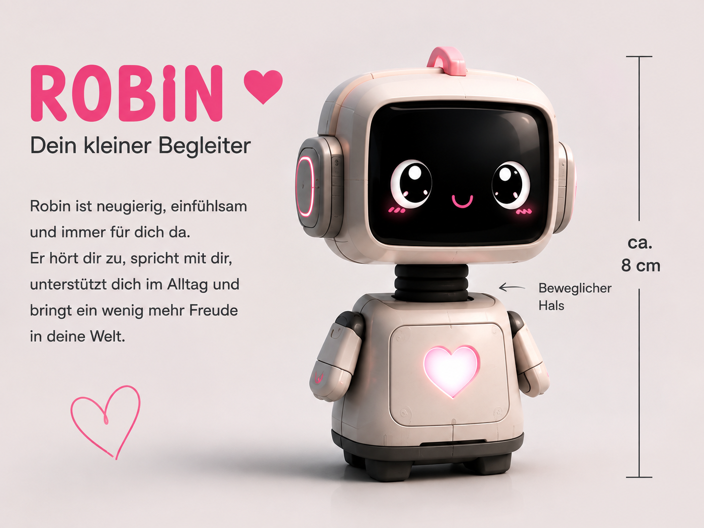
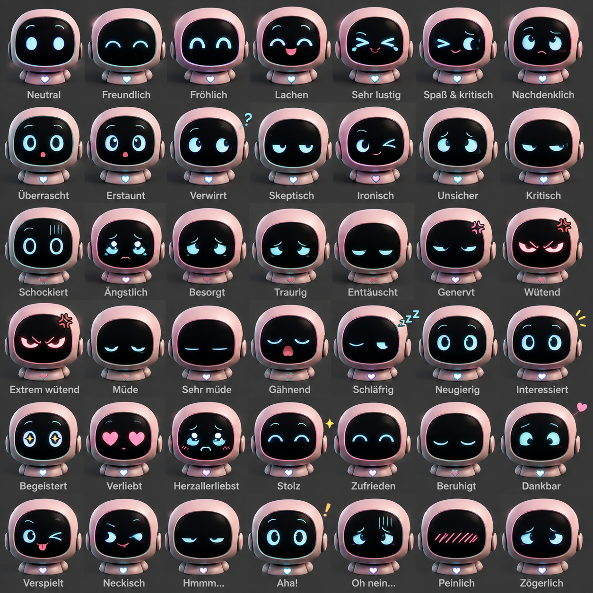

# Pink Robin

🌐 **Projektwebsite:** [pinkrobin.wanderwusel.ch](https://pinkrobin.wanderwusel.ch)

Begleitroboter mit Embedded-Software, gemeinsamem C++-Verhaltenskern und Angular-Weboberfläche.

**Stand:** Angular-Demo und ASP.NET-Core-Status-API laufen. Der portable C++-Core ist an das Backend angebunden; Angular steuert Berührungen über getrennte Backend-Sitzungen und zeigt Core-Zustände an.

## In Visual Studio starten

1. [PinkRobin.slnx](PinkRobin.slnx) im Repository-Hauptverzeichnis öffnen.
2. Falls nötig, **PinkRobin.Api** als Startprojekt festlegen.
3. Neben dem grünen Startknopf **PinkRobin Demo** wählen und **F5** drücken.

Damit starten Backend und Angular gemeinsam. Der native C++-Core wird automatisch
mitgebaut und vom Backend geladen. Voraussetzungen und Details:
[Entwicklungsstart](backend/README.md#in-visual-studio-mit-dem-grünen-startknopf).
Die Datei `PinkRobin.code-workspace` ist für Visual Studio Code bestimmt; das
Öffnen des Repository-Ordners als CMake-Projekt startet nur die separate Core-Demo.

## Projektstruktur

| Verzeichnis | Aufgabe / vorgesehene Technologien |
| --- | --- |
| [core/](core/) | Portabler C++-Verhaltenskern; native Tests und serverseitige Anbindung |
| [firmware/](firmware/) | Hardwareadapter und Roboter-Firmware; ESP32-S3, C/C++, ESP-IDF und FreeRTOS als vorgesehener Einstieg |
| [backend/](backend/) | ASP.NET Core / C# API, Demo-Sitzungen und nativer C++-Core; später EF Core / SQL |
| [web/](web/) | Angular, TypeScript und HTML/CSS; Websimulator und spätere Status-/Konfigurationsoberfläche |
| [mobile/](mobile/) | Companion-App mit .NET MAUI, C# und MVVM |
| [docs/](docs/) | Anforderungen, Systemarchitektur, Protokoll und Technologieentscheidungen |
| [tests/](tests/) | Komponentenübergreifende Integrations- und End-to-End-Szenarien |
| [tools/](tools/) | Entwicklungs-, Build- und Diagnosewerkzeuge |
| [assets/](assets/) | Bilder und weitere Projektressourcen |

## Ausdruck & Interaktion

Pink Robin soll Emotionen und Zustände nicht nur sprachlich, sondern auch visuell über Augen, Mimik und Bewegung vermitteln.

## Architektur und Umsetzung

Der portable C++-Core läuft auf dem Roboter lokal und für Virtual Robin nativ auf dem Server hinter ASP.NET Core. Angular stellt den Simulator dar und kommuniziert über HTTPS sowie den vorgesehenen SignalR-Echtzeitkanal. Das Backend lädt den Core als native Bibliothek über dessen C-Schnittstelle. Der Websimulator benötigt eine Serververbindung; der physische Grundbetrieb bleibt offline verfügbar.

Die Angular-Weboberfläche ist unter https://pinkrobin.wanderwusel.ch über einen NGINX-Container und Synology-Reverse-Proxy mit HTTPS erreichbar. Backend, Core und Build-Pipeline sind implementiert; neue Backend-Versionen werden separat auf der NAS installiert.

Getrennte Backend-Sitzungen verbinden Berührungen mit dem Angular-Gesicht. Weitere Bewegungen und ein Nickauftrag sind als nächste Erweiterungen vorgesehen. Details: [Technologiekonzept](docs/Technologiekonzept.md).

## Repository und CI/CD

PinkRobin ist aktuell ein öffentliches Repository. Der erste C++-Core im Anfangsstadium ist ausdrücklich zur Veröffentlichung freigegeben (16. Oktober 2026). Die frühere Vorgabe eines privaten Cores ist für diesen frühen Stand aufgehoben; dies ist keine pauschale Freigabe späterer vertraulicher Bestandteile. Ein weiteres öffentliches Repository wird nicht automatisch aus main gespiegelt.

GitHub Actions prüft dev und main, baut und veröffentlicht auf main versionierte Frontend-/Backend-Images. Die Synology holt Frontend-Releases automatisch ab; Backend-Releases werden zunächst manuell installiert. Webseitenbereitstellung und öffentliche Quellcode-Freigabe sind getrennte Abläufe.

## Dokumentation

- [Lastenheft](docs/Lastenheft.md)
- [Systemarchitektur](docs/Systemarchitektur.md)
- [Technologiekonzept](docs/Technologiekonzept.md)
- [Robin Protocol](docs/Robin-Protocol.md)
- [Robin Principles – Privatsphäre & Ethik](docs/Robin-Principles.md)
- [Architekturübersicht der Verzeichnisse](docs/architecture/README.md)
- [API-Dokumentation](docs/api/README.md)
- [Entscheidungsprotokolle](docs/decisions/README.md)

## Backend-Vorbereitung

Ein ausführbares ASP.NET-Core-Grundgerüst mit Status-API, Gesundheitsprüfungen,
Core-Schnittstelle und eigenem CI-/Docker-Test ist unter [backend/](backend/)
vorbereitet. Die native Core-Anbindung ist implementiert; die neue Version muss separat auf der NAS ausgeliefert werden.

## Erster nativer Core

Unter [core/](core/) ist der erste portable C++17-Verhaltenskern implementiert:
Aufwachen, Herzreaktion und Kopfstreicheln mit Herzaugen. CMake, Tests und eine
versionierte C-Schnittstelle bilden die Grundlage der C#-Anbindung. Das Backend
lädt den Core nativ; Angular verwendet ihn über die Sitzungs-API; ohne Backend steht eine gekennzeichnete lokale Demo bereit.
