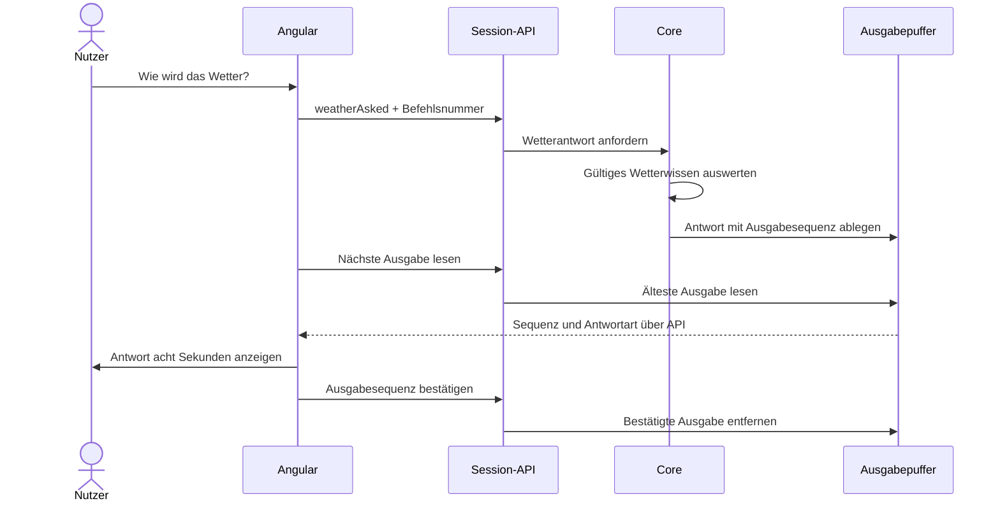

# Core-Ausgaben

Der Core erzeugt typisierte Ausgaben. Adapter übernehmen deren
Transport und Darstellung. Die deutschen Texte liegen in Angular;
der Core liefert die Bedeutung einer Antwort.

## Ablauf einer Wetterfrage



## Antwortarten

| Wert | Bedeutung |
| --- | --- |
| `unknown` | Keine aktuell gültigen Wetterdaten vorhanden |
| `dry` | Kein Niederschlag prognostiziert |
| `rain` | Niederschlag prognostiziert |
| `storm` | Mindestens 10 mm Niederschlag und Böen ab 60 km/h |

`storm` ist eine interne Einordnung des Prototyps und keine
amtliche Unwetterwarnung.

Die Frage verwendet das vorhandene WorldModel. Sie lädt keine
neuen Wetterdaten und löst keine Verwandlung aus.

## Ausgabepuffer

- Jede Core-Instanz besitzt einen eigenen Puffer mit acht Plätzen.
- Ausgaben erhalten fortlaufende Sequenznummern ab 1.
- Lesen entfernt keine Ausgabe.
- Bestätigt werden kann die jeweils älteste wartende Ausgabe.
- Bereits bestätigte Sequenznummern dürfen erneut bestätigt werden.
- Ein voller Puffer weist neue Ausgaben ab.
- Eine abgewiesene Ausgabe verbraucht keine Sequenznummer.
- Sequenznummern laufen nicht über; bei Erschöpfung wird abgewiesen.

Die Ausgabesequenz ist von der Befehlsnummer unabhängig.
Sequenznummern gelten nur innerhalb ihrer Session.

## HTTP-Schnittstelle

Alle folgenden Aufrufe verwenden den Header `X-Robin-Session`.

| Methode | Pfad | Zweck |
| --- | --- | --- |
| POST | `/api/v1/session/events` | Befehl `weatherAsked` senden |
| GET | `/api/v1/session/outputs/next` | Älteste Ausgabe lesen |
| POST | `/api/v1/session/outputs/ack` | Ausgabe bestätigen |

Das Lesen liefert bei vorhandenem Inhalt HTTP 200, andernfalls
HTTP 204.

Beispiel einer Ausgabe:

```json
{
  "sequence": "1",
  "kind": "weatherAnswer",
  "weatherAnswer": "rain"
}
```

Beispiel einer Bestätigung:

```json
{
  "sequence": "1"
}
```

Die Ausgabesequenz wird als Dezimalstring übertragen, damit
JavaScript auch grosse 64-Bit-Werte unverändert verarbeitet.

Die bestehende Befehlsprüfung verhindert, dass eine Wiederholung
des zuletzt angenommenen Befehls mit derselben Befehlsnummer
eine zweite Antwort erzeugt.

## Darstellung in Angular

Der Session-Service hält höchstens eine lokale Ausgabe bereit.
Solange sie wartet, wird sie nicht durch eine weitere ersetzt.

Robin zeigt die Antwort über `displayedSpeech` an. Seine normalen
Begrüssungs- und Berührungstexte bleiben separat erhalten.

Nach acht Sekunden versucht Angular die Ausgabe zu bestätigen.
Bei einem Fehler bleibt sie sichtbar; die Bestätigung wird nach
zwei Sekunden erneut versucht. Nach erfolgreicher Bestätigung
erscheint wieder der normale Text.

Der Antwort-Timer wird unabhängig von den Animationstimern
verwaltet und beim Wechsel der Ausgabe oder beim Zerstören der
Komponente bereinigt.

## Grenzen

Die Bestätigung ist eine Empfangsbestätigung des Adapters.
In Angular erfolgt sie derzeit nach der Anzeigedauer. Sie ist
kein allgemeines Signal für abgeschlossene Aktionen.

Die Puffer liegen im Arbeitsspeicher. Session-Ende oder
Backend-Neustart können unbestätigte Ausgaben verwerfen.
Eine dauerhafte oder exakt einmalige Zustellung über Neustarts
hinweg ist damit nicht zugesichert.