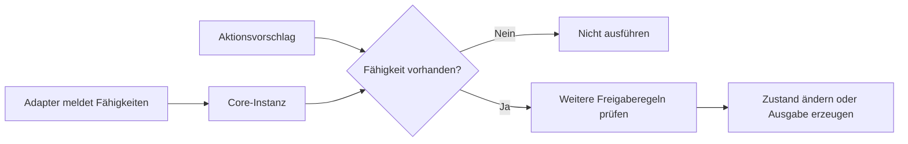

# Plattformfähigkeiten

Der Adapter meldet beim Erstellen einer Core-Instanz, welche
Darstellungsmöglichkeiten tatsächlich implementiert sind.
Der Core erkennt weder Plattform noch Hardware selbst.

## Erster Umfang

| Fähigkeit | Bedeutung |
| --- | --- |
| `text_output` | Wetterantworten können als Text dargestellt werden |
| `outfit_display` | Die vorhandenen Verwandlungen können dargestellt werden |

Ohne ausdrückliche Meldung sind beide Fähigkeiten deaktiviert.
Wetterwissen und Berührungszustände werden weiterhin verarbeitet.

## Ablauf

Eine Fähigkeit beschreibt die grundsätzliche Ausführbarkeit.
Aktionsressourcen beschreiben dagegen die momentane Belegung.
Zustandsregeln und Wetter-Cooldown bleiben davon getrennt.

## Verhalten

- Spontane Wetterverwandlungen benötigen `outfit_display`.
- Direkt angeforderte Verwandlungen ohne diese Fähigkeit liefern
  `Result::unsupported`.
- Wetterantworten benötigen `text_output`. Fehlt die Fähigkeit,
  entstehen weder Ausgabe noch neue Ausgabesequenz.
- Eine reine Textplattform kann Wetterwissen speichern und
  Wetterfragen beantworten, ohne eine Verwandlung darzustellen.
- Direkte Wetterantworten warten weiterhin nicht auf Outfit-Freigabe
  oder den Cooldown spontaner Wetteraktionen.

## Native Schnittstelle

`robin_core_create_with_capabilities()` erhält Startzeit,
Fähigkeitsstruktur und Strukturgrösse.

`robin_platform_capabilities_v1` enthält zwei `uint32_t`-Felder.
Nur die Werte 0 und 1 sind erlaubt. Ungültige Angaben oder eine
fehlgeschlagene Speicherreservierung liefern einen Nullzeiger.

Der bisherige Aufruf `robin_core_create()` bleibt vorhanden,
erstellt jetzt aber eine Instanz ohne Darstellungsfähigkeiten.
Bestehende Aufrufer, die Wetterantworten oder Verwandlungen
benötigen, müssen auf den neuen Aufruf umgestellt werden.

Fehlende Fähigkeiten werden über `ROBIN_UNSUPPORTED` mit dem
Wert 7 gemeldet. Die bestehenden Strukturlayouts bleiben erhalten;
die ABI-Versionsnummer ist weiterhin 1. Das bedeutet keine
unveränderte Verhaltenskompatibilität des alten Erstellungsaufrufs.

## Backend

`CorePlatformCapabilities` wird über `IRobinCoreGateway` an
`NativeRobinCore` weitergereicht.

Der aktuelle Web-Session-Adapter meldet Textausgabe und
Outfit-Darstellung ausdrücklich. Die allgemeine Core-Fabrik
aktiviert selbst keine Fähigkeiten.

C# übersetzt `ROBIN_UNSUPPORTED` in `NotSupportedException`.

## Grenzen

Die Fähigkeiten werden beim Erstellen kopiert und bleiben für
die Lebensdauer dieser Instanz unverändert.

Dieser erste Umfang enthält keine Hardwareerkennung, Registry,
Berechtigungsverwaltung oder allgemeine Aktionsreservierung.
Spätere Änderungen der Verfügbarkeit und weitere Fähigkeiten
werden bei konkretem Bedarf ergänzt.