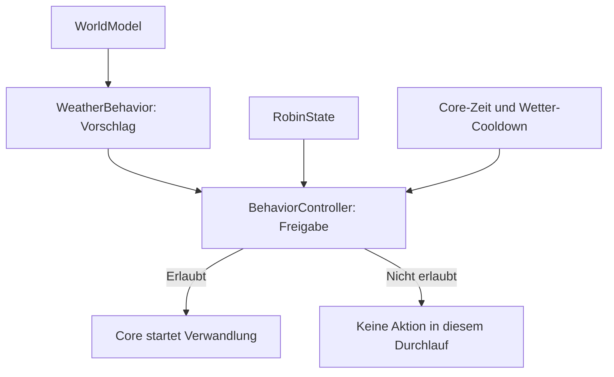

# Verhaltensauswahl und Freigabe

Die Verhaltensverarbeitung ist zunächst für Wetterverwandlungen
in getrennte Bausteine aufgeteilt.

## Verantwortlichkeiten

| Baustein | Aufgabe |
| --- | --- |
| WorldModel | Aktuelles Umweltwissen bereitstellen |
| RobinState | Robins eigenen Zustand bereitstellen |
| WeatherBehavior | Eine passende Wetterverwandlung vorschlagen |
| BehaviorController | Freigabe und Wetter-Cooldown prüfen |
| Core | Freigegebenen Vorschlag ausführen und Zeit fortschreiben |

## Wettervorschläge

Die bisherigen Auswahlregeln bleiben erhalten:

- Niederschlag mindestens 10 mm und Böen mindestens 60 km/h: Octopus.
- Sonst Niederschlag mindestens 0,5 mm: Regenmantel.
- Sonst oder ohne Wetterwissen: kein Vorschlag.

WeatherBehavior verändert weder Zustand noch Umweltwissen.
Das WorldModel wird beim Core-Zeitfortschritt von abgelaufenem
Wetterwissen bereinigt.

## Freigabe

Eine Verwandlung darf starten, wenn Robin:

- wach und neugierig ist,
- keinen aktiven Kopfkontakt hat,
- keine andere Verwandlung ausführt.

Damit bleibt auch die vorübergehende Freude nach einer
Herzberührung geschützt.

Spontane Wetteraktionen werden beim nächsten freien
Verarbeitungszeitpunkt erneut geprüft. Eine zusätzliche feste
Zehn-Sekunden-Wartezeit gibt es nicht mehr.

Der Vorschlag wird jedes Mal aus dem aktuellen Wetterwissen
ermittelt; eine separate wartende Outfit-Absicht wird nicht gespeichert.

## Dauer und Wiederholungsschutz

Eine gestartete Verwandlung dauert weiterhin zehn Sekunden.

Der BehaviorController verwaltet den gemeinsamen
30-Minuten-Cooldown für spontane Wetterverwandlungen.
Er beginnt erst beim tatsächlichen Start, nicht bei einer Abfrage.

Core-Zeit, Verwandlungsdauer und Revision werden weiterhin
vom Core verwaltet. Kein Baustein besitzt einen eigenen Timer.

## Noch nicht umgesetzt

Dieser Stand ist der erste Ausbau von Issue #8.
Allgemeine Aktionsprioritäten, Motivation, zufällige Auswahl
und die Koordination weiterer Aktionsarten fehlen noch.

Eine direkte Wetterfrage soll später unmittelbar beantwortet
werden können, unabhängig vom Outfit-Cooldown.
Dieser Anfrage- und Antwortweg ist noch nicht implementiert.

## Tests

Geprüft werden Wetter-Schwellenwerte, Freigabe bei verschiedenen
Zuständen, die genaue Cooldown-Grenze, Rückwärtszeit und der Start
nach dem Ende einer beschäftigenden Interaktion.

Die typisierten Aktionsvorschläge und Ressourcenregeln sind in
[Aktionskoordination.md](Aktionskoordination.md) beschrieben.