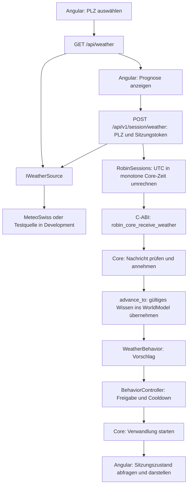

# Wetterwissen und Verwandlungen

Das Backend beschafft Wetterprognosen. Der portable C++-Core hält
das Wetterwissen, ermittelt Vorschläge und entscheidet über deren
Ausführung. Angular stellt den tatsächlichen Zustand dar.

## Datenfluss



Der POST beschafft die Prognose serverseitig anhand der PLZ.
Angular übermittelt keine eigenen Wetterwerte.
`X-Robin-Session` ordnet den Aufruf einer Sitzung zu.

Die synchron arbeitende C-ABI-Funktion nimmt an und verarbeitet
anschliessend. Die reine C++-Annahme durch `receive()` ist davon getrennt.

`{"accepted": true}` bestätigt die Annahme, keinen gestarteten Effekt.
Die Sitzungsabfrage liefert die tatsächlich aktive Verwandlung.

## Datenquelle

Bei MeteoSwiss verwenden die Wetteraufrufe denselben Stunden-Cache.
In Development stehen alternativ die Testfälle Dry, Rain und Storm
zur Verfügung.

[Konfiguration und Testablauf](../../backend/WEATHER.md).

## Nachrichten und Wetterwissen

Der Core prüft Quelle, Empfangszeit, endliche Wetterwerte,
nicht negative Niederschlags-/Windwerte und das Gültigkeitsintervall.
Negative Temperaturen sind erlaubt.

Ein einzelner Wetterplatz hält eine noch nicht übernommene Prognose:

- Eine neue gültige Prognose ersetzt die wartende.
- Ungültige Ersatzdaten verändern die wartende Prognose nicht.
- Die Übernahme erfolgt frühestens ab Empfang und Gültigkeitsbeginn.
- Vorhandenes gültiges Wissen bleibt bis zur Übernahme oder seinem Ablauf erhalten.

Das WorldModel speichert die übernommene Prognose mit Quelle und
Empfangszeit. Abgelaufenes Wissen wird beim Zeitfortschritt entfernt.
Unbekanntes Wetter bedeutet nicht trockenes Wetter.

Interaktionen verwenden einen separaten Ringpuffer mit acht Plätzen.
Details: [Nachrichtenvertrag](Nachrichtenvertrag.md) und
[WorldModel](WorldModel.md).

## Auswahl und Freigabe

| Bedingung | Vorschlag |
| --- | --- |
| Niederschlag mindestens 10 mm und Böen mindestens 60 km/h | Octopus |
| Sonst Niederschlag mindestens 0,5 mm | Gelber Regenmantel |
| Sonst oder ohne Wetterwissen | Keine Verwandlung |

Diese Schwellenwerte sind eigene Prototypregeln, keine offiziellen
Unwetterwarnungen. Niederschlag kann auch Schnee enthalten.

WeatherBehavior ermittelt den Vorschlag.
BehaviorController prüft, ob Robin wach und neugierig ist,
keinen Kopfkontakt hat und keine andere Verwandlung ausführt.

Ist Robin beschäftigt, erfolgt beim nächsten freien
Verarbeitungszeitpunkt eine erneute Entscheidung aus dem aktuellen Wissen.
Es gibt keine zusätzliche feste Zehn-Sekunden-Wartezeit.

## Dauer und Cooldown

Die Verwandlung dauert weiterhin zehn Sekunden.

Der gemeinsame 30-Minuten-Cooldown für spontane Wetterverwandlungen
beginnt erst bei einem tatsächlichen Start und liegt im BehaviorController.
Ein anderer Wettervorschlag setzt ihn nicht zurück.

Eine bereits aktive Verwandlung läuft bis zu ihrem Ende weiter.
`restart` beendet die aktive Verwandlung; Wetterwissen und
Wetter-Cooldown bleiben innerhalb derselben Core-Instanz erhalten.

Der Core besitzt keinen eigenen Timer oder Thread.
Verarbeitung erfolgt durch `advance_to()`.
Eine neue Sitzung erhält einen neuen Core ohne bisherigen Cooldown.

Details: [Verhaltensauswahl und Freigabe](Verhalten.md).

## Zeitbasis und native Schnittstelle

Die Backend-Prognose verwendet UTC. RobinSessions rechnet ihre
Gültigkeit in monotone Millisekunden der jeweiligen Core-Instanz um.
Empfangszeit und Prognosegültigkeit bleiben unterschiedliche Angaben.

Es gilt das halboffene Intervall:
`[valid_from_ms, valid_until_ms)`.

`robin_weather_v1` enthält vier double-Werte und zwei uint64_t-Zeitwerte.
Die Struktur umfasst 48 Bytes; valid_from_ms beginnt bei Byte 32.
Der ABI-v1-Snapshot bleibt unverändert.
Die aktive Verwandlung wird separat über die native Schnittstelle gelesen.

## Prüfung

Im Repository-Hauptordner:

```powershell
cmake --build core/build --config Release
ctest --test-dir core/build -C Release --output-on-failure
dotnet run --project backend/tests/Interop -c Release
```

CTest trennt Grundverhalten, Wetter, Nachrichten, WorldModel und C-ABI.
Die Tests verwenden künstliche Daten und steuerbare Zeit.

## Weitere Entwicklung

Direkte Wetterfragen sollen unmittelbar beantwortet werden können,
ohne auf eine freie Outfit-Aktion oder deren Cooldown zu warten.
Der Anfrage- und Antwortweg ist noch nicht implementiert.

Allgemeine Aktionsprioritäten, Persönlichkeit, dauerhafte Vorlieben,
Sprachausgabe und Companion-Anbindung bleiben weitere Ausbauschritte.