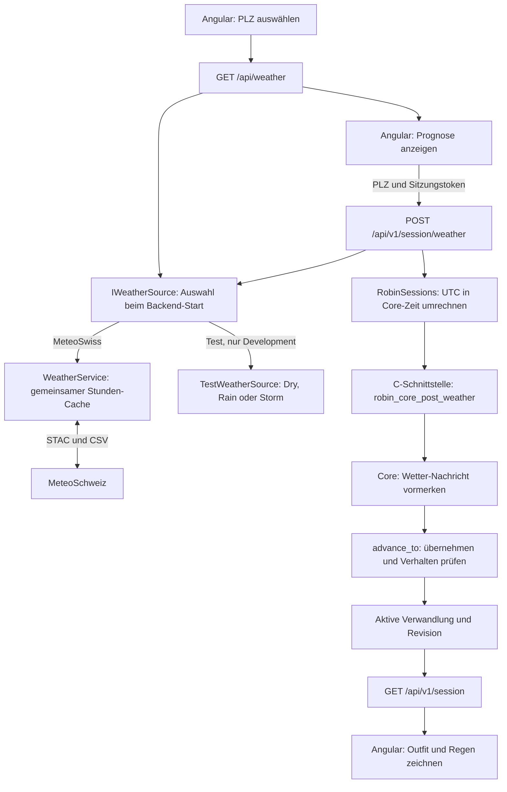
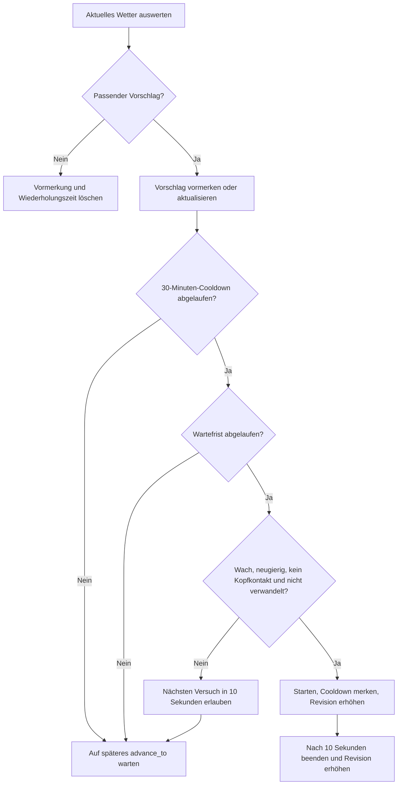

# Wetterwissen und Verwandlungen

Stand: 22.10.2026. Robin erhält eine Wetterprognose und entscheidet im C++-Core,
ob eine Verwandlung passt und wann sie starten darf. Angular stellt den aktiven
Zustand dar. Das Backend beschafft und übersetzt die Daten.

## Datenfluss



Die beiden HTTP-Wetteraufrufe verwenden dieselbe ausgewählte Wetterquelle. Bei
MeteoSchweiz teilen sie sich den Stunden-Cache. In Development kann stattdessen
künstliches Testwetter gewählt werden. Der POST beschafft die Prognose serverseitig
anhand der PLZ; Angular übermittelt keine eigenen Wetterwerte.
[Konfiguration und Testfälle](../../backend/WEATHER.md#echte-prognosen-oder-künstliches-testwetter).
`X-Robin-Session` ordnet die Nachricht einer bestehenden Sitzung zu.
`{"accepted": true}` bestätigt die Annahme der Nachricht, keinen gestarteten Effekt.
Die Sitzungsabfrage liefert dagegen den tatsächlichen Zustand als
`transformation: "none"`, `"octopus"` oder `"raincoat"`.

## Zuständigkeiten und Dateien

| Teil | Aufgabe | Einstieg |
|---|---|---|
| Angular | PLZ, Wetteranzeige, Übergabe an Sitzung | [Robin-Seite](../../web/src/app/robin-page.component.ts) |
| Wetterdienst | Normalisierte MeteoSchweiz-Prognose, gemeinsamer Cache | [WeatherService.cs](../../backend/src/PinkRobin.Api/Weather/WeatherService.cs) |
| Sitzung | Eigener Core pro Robin, Zeitumrechnung, synchronisierter Zugriff | [RobinSessions.cs](../../backend/src/PinkRobin.Api/Sessions/RobinSessions.cs) |
| Native Anbindung | C#-Datenlayout und C-Funktionen | [NativeRobinCore.cs](../../backend/src/PinkRobin.Api/Core/NativeRobinCore.cs), [c_api.h](../../core/include/pinkrobin/c_api.h) |
| Core | Wetterwissen, Auswahl, Wartezeit, Dauer und Cooldown | [core.cpp](../../core/src/core.cpp), [weather.hpp](../../core/include/pinkrobin/weather.hpp) |
| Darstellung | Gelber Mantel, Tentakel und Regen | [Robin-Template](../../web/src/app/robin.component.html) |

Die C#-Wetter-ReactionEngine ist entfernt. `WeatherReactionRequest` ist lediglich
noch das PLZ-Datenpaket des POST-Endpoints, keine Entscheidungslogik.

## Nachrichtenplatz und Wetterwissen

`post_weather` prüft endliche Zahlen, nicht negative Niederschlags-/Windwerte und
ein gültiges, noch nicht abgelaufenes Zeitintervall. Negative Temperaturen sind erlaubt.

- `pending_weather_`: genau ein Platz für eine unverarbeitete `WeatherUpdated`-Nachricht.
  Eine gültige, später eingehende Nachricht ersetzt die vorgemerkte Nachricht.
  Eine ungültige Nachricht wird abgewiesen und überschreibt sie nicht.
- `weather_`: aktuell übernommene Prognose. Eine zukünftige Nachricht wartet bis zu
  ihrem Beginn; vorhandenes gültiges Wetterwissen bleibt bis dahin verfügbar.
- `advance_to`: übernimmt gültige Nachrichten und entfernt abgelaufene Prognosen.

Das ist ein begrenzter Wetter-Nachrichtenplatz, noch keine allgemeine FIFO-Warteschlange.
Die Reihenfolge ist die Ankunftsreihenfolge; eine Prüfung der Prognoseversion gibt es
noch nicht. Berührungen werden weiterhin direkt über `dispatch` verarbeitet.

## Entscheidung und Ablauf

Die Reihenfolge in `choose_weather_transformation` bestimmt die Priorität:

| Bedingung | Verwandlung |
|---|---|
| Niederschlag ≥ 10 mm **und** Böen ≥ 60 km/h | Octopus |
| Sonst Niederschlag ≥ 0,5 mm | Gelber Regenmantel |
| Sonst oder ohne gültige Prognose | Keine |

Die Werte sind eigene Prototypregeln, keine offiziellen Unwetterwarnungen.
Niederschlag ist die prognostizierte Stundensumme einschließlich möglichem Schnee.



Der Cooldown beginnt beim tatsächlichen automatischen Start und gilt gemeinsam
für Wetterverwandlungen. Ein geänderter Vorschlag setzt die Wiederholungswartezeit
zurück, aber nicht den Cooldown. Ohne passenden Wettervorschlag wird eine wartende
Absicht verworfen. Eine bereits aktive Verwandlung läuft bis zu ihrem Ende weiter.
`restart` beendet eine aktive Verwandlung; Wetterwissen und Wetter-Cooldown bleiben
im aktuellen Code innerhalb derselben Core-Instanz erhalten.

Der Core hat keinen eigenen Timer oder Thread. Alle Zeitregeln werden beim nächsten
`advance_to` geprüft. Die Websitzung fragt normalerweise alle 250 ms ab; bei fehlenden
Aufrufen gibt es keine selbstständige Verarbeitung. Sitzungszustand ist flüchtig:
Eine neue Sitzung erhält einen neuen Core ohne bisherigen Cooldown.

## Zwei Zeitachsen

Die API-Prognose verwendet UTC. `ToCoreWeather` bildet ihre Gültigkeit auf die
monotonen Millisekunden der jeweiligen Sitzung ab. Bereits begonnene Intervalle
beginnen für den Core jetzt; zukünftige Intervalle behalten ihren Abstand.
Der Beginn wird auf-, das Ende abgerundet. Überläufe werden mit `checked` erkannt.

Beispiel: UTC jetzt 12:00, Core-Zeit 8000 ms, Prognose gültig bis 12:10.
Das Ende wird zu `608000 ms`. Es gilt immer `[valid_from_ms, valid_until_ms)`.

Die C-Struktur `robin_weather_v1` enthält vier `double`-Werte und zwei `uint64_t`-
Zeitwerte. Ihr Layout umfasst 48 Bytes; `valid_from_ms` liegt ab Byte 32.
C# verwendet die entsprechende sequenzielle Struktur. Der bestehende ABI-v1-Snapshot
bleibt unverändert; die aktive Verwandlung wird separat nativ ausgelesen.

## Prüfen und weiterentwickeln

Aus der Repository-Wurzel, jeweils erst nach erfolgreichem Build weiterfahren:

```powershell
cmake -S core -B core/build -DBUILD_TESTING=ON
cmake --build core/build --config Release
ctest --test-dir core/build -C Release --output-on-failure
dotnet run --project backend/tests/Interop -c Release
```

[Core-Tests](../../core/tests/core_tests.cpp) prüfen Gültigkeitsgrenzen,
Nachrichtenersetzung, automatische Auswahl, Wartezeit, Cooldown und das Verwerfen
überholter Absichten. [Interop-Tests](../../backend/tests/Interop/Program.cs) prüfen
native Übergabe, UTC-Umrechnung und die Trennung zweier Sitzungen. Die Tests verwenden
künstliche Daten und steuerbare Zeit; sie benötigen keinen echten Regen.

Die gelbe Farbe ist derzeit Teil der Angular-Darstellung. Dauerhafte Vorlieben,
Sprachausgabe und die Companion-App-Anbindung sind noch nicht implementiert.
Die Companion-App kann später denselben Core-Nachrichteneingang nutzen; Standort,
Netzwerk und die Umrechnung ihrer Zeitachse bleiben Aufgaben des jeweiligen Adapters.
Details zur Datenquelle und PLZ-Konfiguration: [Backend-Wetterdienst](../../backend/WEATHER.md).
