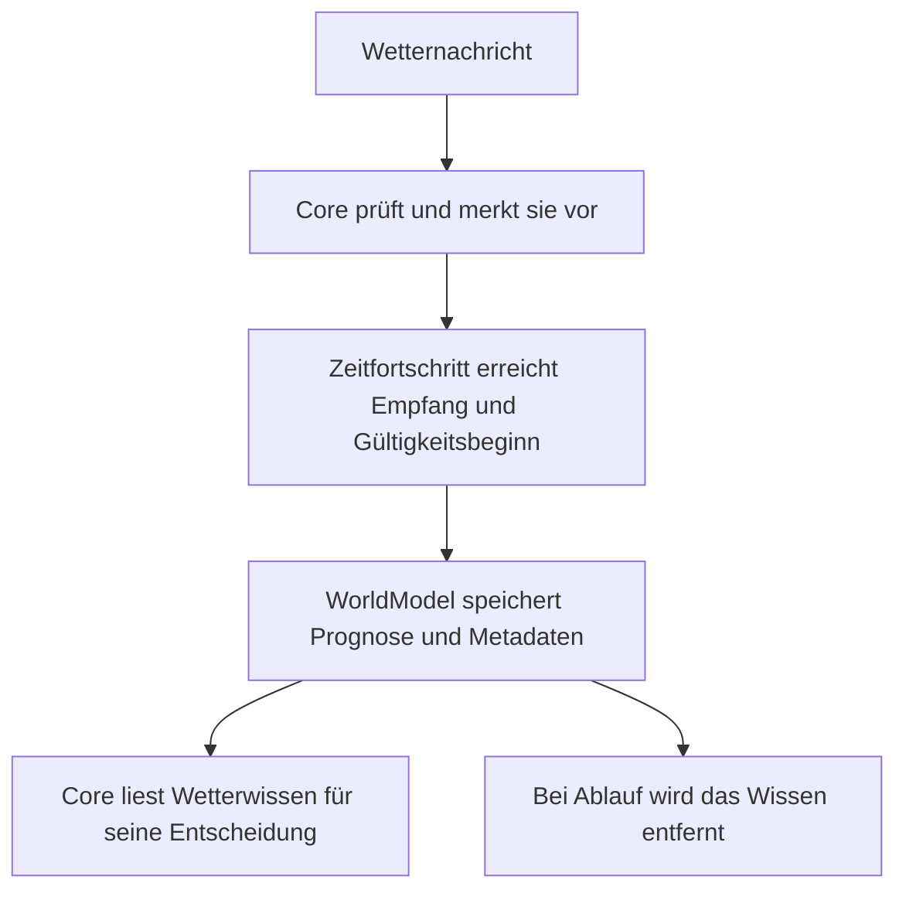

# World-Model: Wetterwissen

Das WorldModel speichert Robins aktuelles Umweltwissen.
Es entscheidet nicht, wie Robin darauf reagiert.

## Erster Umfang

Zunächst enthält das Modell einen optionalen Wettereintrag:

- Prognose mit Temperatur, Niederschlag, Wind und Gültigkeit
- Herkunft der Nachricht
- Empfangszeit auf der monotonen Core-Zeitbasis

`WeatherObservation` bezeichnet hier eine empfangene Information.
Ihr Inhalt ist weiterhin eine Prognose, keine direkte Messung.

Kein Eintrag bedeutet unbekanntes Wetter, nicht trockenes Wetter.

## Ablauf

Eine ungültige neue Prognose ersetzt keine gültige wartende.
Neue gültige Prognosen können wartende ersetzen.

Die Übernahme ins WorldModel erfolgt erst bei der Verarbeitung.
Die Annahme allein verändert das Modell nicht.

## Verantwortlichkeiten

Der Core prüft Quelle, Wetterwerte, Empfangszeit und Gültigkeit.
Er übergibt bereits geprüfte und aktuell gültige Informationen
an `WorldModel::update_weather()`.

Das WorldModel:

- speichert oder ersetzt den Eintrag,
- liefert über `weather()` eine Kopie des optionalen Eintrags,
- entfernt über `expire_weather()` abgelaufene Informationen,
- startet keine Animationen und benötigt keine eigene Uhr.

Ab `valid_until_ms` ist die Prognose ungültig.
Der Core stösst die Ablaufprüfung beim Zeitfortschritt an.

## Zugriff

`Core::world()` stellt das Modell nur lesend bereit.
Die Referenz gilt nur während der Lebensdauer des Cores.
Zugriffe müssen wie bisher serialisiert werden.

`Core::weather()` bleibt als bisherige Prognoseabfrage erhalten.
Sie liest denselben Wissensstand aus dem WorldModel.

Jede Core-Instanz besitzt ihr eigenes Modell.

## Herkunft

Neue Wetternachrichten behalten ihre ausdrücklich übergebene Quelle.

Die alte Wetterfunktion ohne Quellenparameter verwendet für den
Kompatibilitätsweg `backend`. Das bezeichnet den Einspeiseweg,
nicht den meteorologischen Datenanbieter.

## Grenzen und weitere Entwicklung

Aktuell werden weder Historie noch dauerhafte Speicherung,
Audio, Kamera oder weitere Umweltinformationen implementiert.

Stimmung, Berührung und aktive Verwandlung bleiben Core-Zustand.
Verhaltensentscheidung und Aktionskoordination werden separat
weiterentwickelt.

## Tests

Geprüft werden Speicherung, Ersetzung, Metadaten, Ablaufgrenze,
getrennte Modellinstanzen und der Nachrichtenweg durch den Core.
Die bestehenden Wetterreaktions- und Interop-Tests bleiben erhalten.